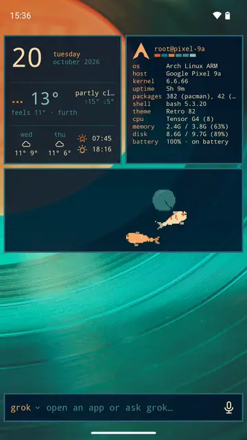

# Omalauncher

An Android home screen with the look of [Omarchy](https://omarchy.org), and an
optional Arch Linux ARM system next to your phone apps. Omalauncher runs the
system under proot, without root, and is its Wayland compositor: every Linux
window opens as its own Android task, with its own card in Recents.

<a href="https://play.google.com/store/apps/details?id=dev.omalauncher"></a>


<p>
  
  
  
  
</p>

- **Themes**: all 22 Omarchy themes, with their wallpapers, applied to the
  launcher and to the Linux apps, plus the community themes from
  [omarchy.org/themes](https://omarchy.org/themes/), or your own in
  `~/.config/omarchy/themes`
- **Widgets** written in OWL, a small declarative language you can edit on the
  phone, plus a [widget store](https://github.com/SimonSchubert/omarchy-widgets)
- **Linux, optional**: pacman and the AUR, Linux apps in their own windows,
  terminal widgets, a file manager, and opt-in GPU acceleration on Mali and Adreno 6xx+ GPUs
- **Coding agents**: the bar at the bottom sends a prompt to Claude Code, Codex,
  Copilot, opencode and others, which open in a terminal
- No account, no ads, no tracking

Needs an arm64 phone with Android 10 or newer. Without Linux, the launcher still
has the themes, wallpapers, Android apps and the widgets that don't run commands.

## Using it

The bar: the one input at the bottom of the home screen opens apps and asks
coding agents. Focusing it opens the list of Linux and Android apps; typing
narrows the list, and Enter opens the highlighted app or sends the text to the
agent. Short queries that name an app open it, sentences go to the agent; Tab
and the arrow keys move the highlight. Tap the agent's name to pick another
installed one; the choice is saved in `~/.config/omalauncher/agent`. Hold the mic to talk and release to send, or tap it to dictate
into the field. Speech is recognized by Android (on the device when the phone
supports it), so only text reaches Linux.

The app drawer is a widget too, `drawer.owl` in the widgets folder, so an
agent can rewrite it. Here Grok sorts it into folders:



Touch input in Linux windows: tap is a left click, long press is a right
click, drag scrolls; apps with touch support (foot, GTK) get real touch.
Hardware keyboard shortcuts: Super+Enter (terminal), Super+Space or
Super+A (the bar), Super+1..9 (home pages) on the home screen; Super+Enter
and Super+W (close) in Linux windows.

## Building

```sh
./scripts/fetch-proot.sh          # Termux's proot -> app/src/main/jniLibs (needs bsdtar)
./gradlew :app:installDebug
# optional: skip the 830 MB download on the device
adb push ArchLinuxARM-aarch64-latest.tar.gz ArchLinuxARM-aarch64-latest.tar.gz.sig /sdcard/Android/data/dev.omalauncher/files/
```

Linux images are downloaded over HTTPS and verified against Arch Linux ARM's pinned signing key before extraction. An ADB-supplied image also needs its matching `.tar.gz.sig`. Existing Linux installations are unchanged. See [Linux download verification](docs/LINUX_DOWNLOAD_VERIFICATION.md).

Tests: `./gradlew :owl:test :app:testDebugUnitTest`. `./gradlew :owl:owlJar`
builds `owl/build/cli/owl.jar`, the checker the widget store's CI runs.

In debug builds you can launch guest commands with
`adb shell am start -n dev.omalauncher/.MainActivity --es exec foot`.

An agent can request a locally built APK without access to ADB or Android
secrets: run `omalauncher-install /root/path/to/app-debug.apk "reason"` in the
guest. Omalauncher checks the guest-visible path and APK metadata, then normally
asks the user to approve the package, hash, signing certificate and permissions
before handing it to Android's PackageInstaller. The request returns only after
the system installer succeeds or rejects it. For deliberate unattended work,
Settings › agent device access has an explicit, off-by-default YOLO mode. It
skips Omalauncher's prompt for validated requests and asks PackageInstaller for
non-interactive installation, but Android or Xiaomi can still require its own
confirmation. YOLO does not expose raw ADB, Android secrets or a root shell.
For other Android actions, the guest can use the same policy with
`omalauncher-device open-package <package> [reason]`,
`omalauncher-device open-component <package>/<exported-activity> [reason]`, or
`omalauncher-device open-url <http-or-https-url> [reason]`. To request two
launchable apps side by side on Android 12L+, use
`omalauncher-device open-split-packages <package-a>,<package-b> [reason]`.
For arbitrary device-side ADB-equivalent work, start Shizuku, grant
Omalauncher access in Settings › agent device access, and use
`omalauncher-device adb-shell '<command>' [reason]`. The exact command is
shown in Omalauncher's approval screen and must be approved for every request;
the bridge uses a one-time capability token, has no interactive TTY, limits
output to 64 KiB and execution to two minutes. This can run commands available
to Android's shell/root identity, but it is not the computer's `adb` transport:
`adb push`, `adb pull`, `adb connect` and `adb devices` still need a host. APK
installation remains on the inspected PackageInstaller path. Android and the
device manufacturer may still decline a split.
On proot-based phones, Codex is configured with `sandbox_mode = "danger-full-access"`
and `approval_policy = "on-request"` because its nested bubblewrap sandbox cannot
start; the Android app UID and proot guest boundary remain in force.

The guest exports its Java/Gradle and Android SDK paths through `JAVA_HOME`,
`ANDROID_HOME` and `ANDROID_SDK_ROOT`; inspect the local device profile before
assuming a JDK, SDK revision, or host-tool architecture. ADB is intentionally
not installed there. Git is part of the guest package set, so an agent can
clone and edit source. Build an app with its Gradle wrapper or `gradle`, then
use `omalauncher-install`; it is approval-gated unless YOLO is explicitly
enabled in Omalauncher's settings. Updating the installed
Omalauncher itself still needs a signer matching the installed APK; the
launcher's private signing key is never exposed to Linux, so that final
self-update step belongs to a host-side signer/development transport.

The launcher does not automatically pull or replace its own source from
GitHub. For this installation, the canonical fork is
`https://github.com/danielsanchezaran/omalauncher`, and its `main` branch is
where the completed local features are kept. An agent updating that checkout
should run `git fetch origin main`, rebase its work onto `origin/main`, run the
Gradle tests and assemble task, and then use the approval-gated installer for
companion APKs. It must preserve dirty worktrees and never reset or force-push
to resolve a conflict. Replacing `dev.omalauncher` itself still requires the
matching host-side signing key.

For phone-local launcher development, the project also has a `custom` build
type. It produces the separately installable package
`dev.omalauncher.custom` (shown as **Omalauncher Custom**) and can be built with
`eval "$(./scripts/prepare-arm64-android-build.sh --shell-env)"` followed by
`./gradlew --no-daemon --max-workers=1 --no-parallel --console=plain -Pandroid.aapt2FromMavenOverride="$OMALAUNCHER_ARM64_BUILD_TOOLS/bin/aapt2" -Pomalauncher.prebuiltNative=true :app:testDebugUnitTest :app:assembleCustom`.
The preparation script downloads checksum-pinned native ARM64 AAPT2/AIDL
packages from the official Termux repository, creates an ignored SDK overlay,
and seeds the generated native libraries from the installed launcher through a
read-only guest bind. Install
`app/build/outputs/apk/custom/app-custom.apk` through `omalauncher-install`.
It is a separate app with separate Linux data, so the original launcher stays
available as a fallback and its Codex sessions/settings are not shared. The
phone-local mode compiles Kotlin/Java/OWL changes; edits to the C++ JNI or
proot build still need the host toolchain and must not be reported as included
in the custom APK.
The repository also caps Gradle at 2 GiB, the Kotlin daemon at 1 GiB, and one
worker so phone-local builds do not consume the whole device.

- [docs/ARCHITECTURE.md](docs/ARCHITECTURE.md): the compositor, rendering, GPU
  acceleration, and how updates reach existing installs
- [docs/RELEASING.md](docs/RELEASING.md): Play releases and store assets
- [app/src/main/assets/widgets/README.md](app/src/main/assets/widgets/README.md):
  the widget language

## Layout

- `app/`: the Android app (Kotlin, Jetpack Compose, and the JNI bridge in `src/main/cpp`)
- `owl/`: the widget language and the `owl` command line, plain Kotlin
- `art/`: SVG masters for the app, agent and store icons
- `store/`: Play listing sources (screenshot frames, privacy policy)
- `fastlane/`: the Play listing and the upload lanes
- `scripts/`: fetching proot and theme colors, rendering icons, screenshots and widget previews

## License

MIT, see [LICENSE](LICENSE), for Omalauncher's own code and artwork. The
coding agents' logos, the symbol font and Omarchy's theme colors are not
covered; [THIRD_PARTY.md](THIRD_PARTY.md) lists them with their sources and
licenses. The app also ships proot, talloc and libandroid-shmem (GPL-2.0,
LGPL-3.0 and BSD-3-Clause, prebuilt by Termux), listed in the app under
settings › licenses.

Omalauncher is an independent project and is not affiliated with or endorsed
by Omarchy, Arch Linux, or the makers of the coding agents it installs.
