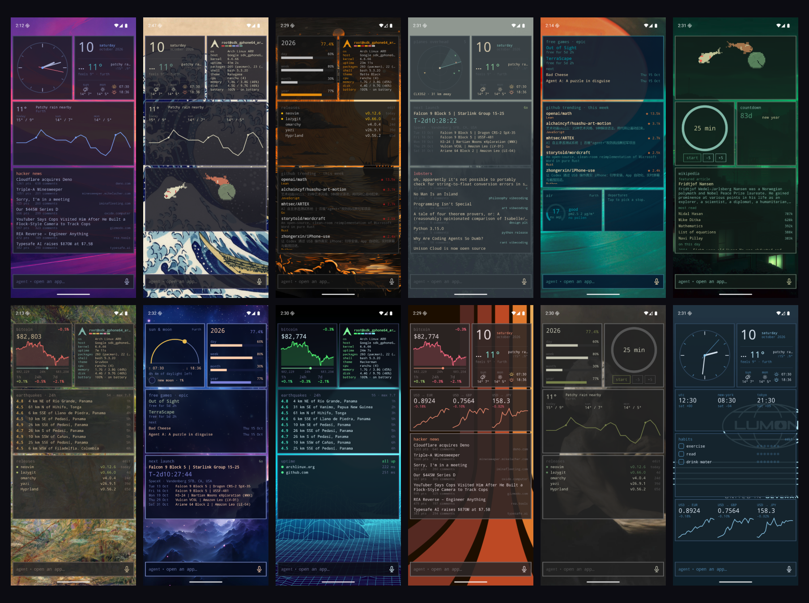
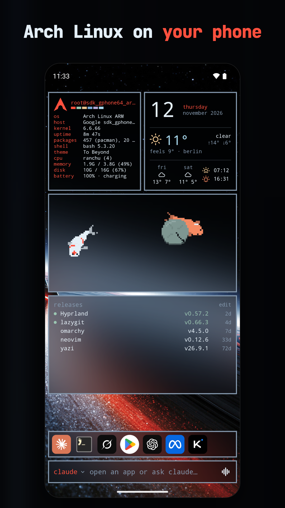
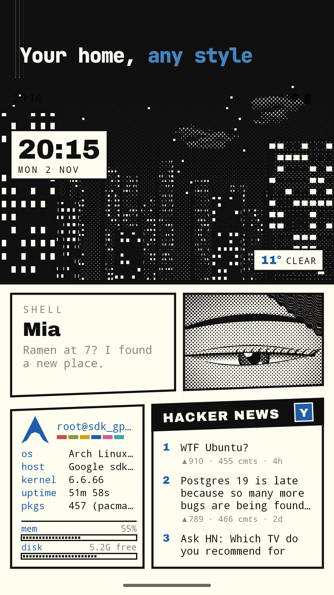
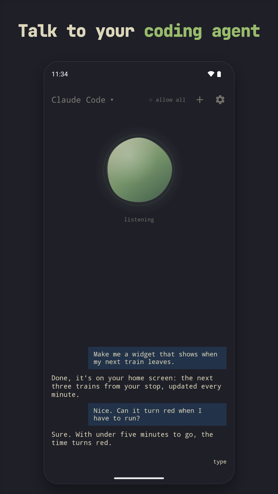
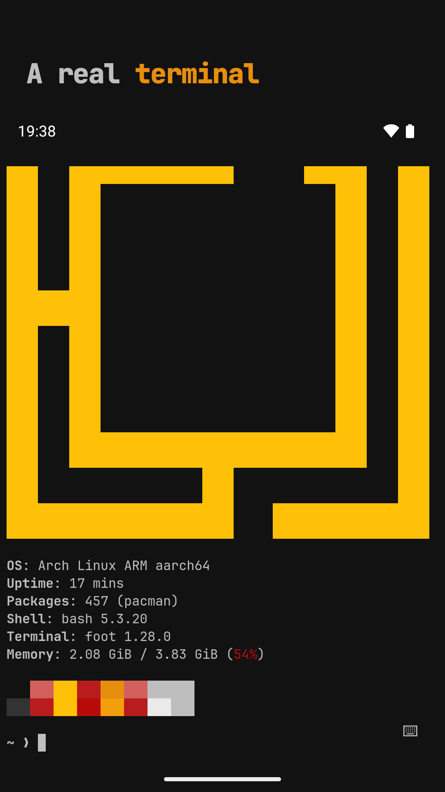
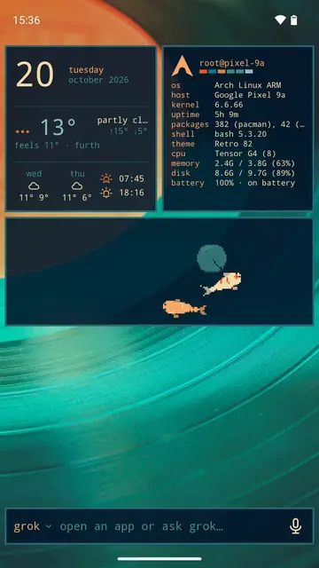

# Omalauncher

An Android home screen with the look of [Omarchy](https://omarchy.org), and an
optional Arch Linux ARM system next to your phone apps. Omalauncher runs the
system under proot, without root, and is its Wayland compositor: every Linux
window opens as its own Android task, with its own card in Recents.

<a href="https://play.google.com/store/apps/details?id=dev.omalauncher"></a>



<p>
  
  
  
  
</p>

- **Themes**: all 22 Omarchy themes, with their wallpapers, applied to the
  launcher and to the Linux apps, plus the community themes from
  [omarchy.org/themes](https://omarchy.org/themes/), or your own in
  `~/.config/omarchy/themes`
- **Widgets** written in OWL, a small declarative language you can edit on the
  phone, plus a [widget store](https://github.com/SimonSchubert/omarchy-widgets)
- **Linux, optional**: pacman and the AUR, Linux apps in their own windows,
  terminal widgets, a file manager, and opt-in GPU acceleration on Mali and Adreno 6xx+ GPUs
- **Coding agents**: the bar at the bottom sends a prompt to Claude Code, Codex,
  Copilot, opencode and others, which open in a terminal
- No account, no ads, no tracking

Needs an arm64 phone with Android 10 or newer. Without Linux, the launcher still
has the themes, wallpapers, Android apps and the widgets that don't run commands.

## Using it

The bar: the one input at the bottom of the home screen opens apps and asks
coding agents. Focusing it opens the list of Linux and Android apps; typing
narrows the list, and Enter opens the highlighted app or sends the text to the
agent. Short queries that name an app open it, sentences go to the agent; Tab
and the arrow keys move the highlight. Tap the agent's name to pick another
installed one; the choice is saved in `~/.config/omalauncher/agent`. Hold the mic to talk and release to send, or tap it to dictate
into the field. Speech is recognized by Android (on the device when the phone
supports it), so only text reaches Linux.

The app drawer is a widget too, `drawer.owl` in the widgets folder, so an
agent can rewrite it. Here Grok sorts it into folders:



### The `omalauncher` command

Scripts and agents in Linux reach the phone through `omalauncher`:

```sh
omalauncher location          # approximate {lat, lon, accuracy, time}
omalauncher calendar 7        # the events of the next 7 days (14 if not given)
omalauncher battery           # level, charging, temperature, health...
omalauncher airpods anc       # the connected AirPods: read them, or change a mode or setting
omalauncher notify "build done" "all tests passed"
omalauncher share report.pdf  # Android's share sheet, for you to pick an app
omalauncher folders           # the phone folders you let Linux reach
omalauncher get Camera/IMG_1.jpg .          # copy from one into Linux
omalauncher put report.pdf Documents        # and back
omalauncher pick              # Android's file picker; what you pick is copied to ~/Downloads
omalauncher version           # the launcher's version and the commands it has
```

It prints JSON and only uses what the launcher was already allowed: it never
asks for a permission itself. Exit codes: 1 nothing to say (no location fix
yet, no AirPods connected), 2 wrong arguments, 3 the launcher isn't allowed
it, 4 the launcher isn't running or didn't answer. `omalauncher --help` has the details. The
coding agents are told about it, so you can ask one to tell you when a long
task is done. `phone`, its name before 0.20, still works.

### Phone files

The launcher asks for no storage permission. Linux has `/sdcard`, but Android
shows it only the files Linux saved there itself: what it puts in
`/sdcard/Download` or `/sdcard/Documents` (pictures in `/sdcard/Pictures`), your
other apps see too (Android 11 and newer). For your own photos, downloads and
documents, add folders at the top of settings, permissions, in Android's folder
picker. Files shows them under "phone folders", where you can open, copy, move,
rename and delete files and copy them to and from Linux; agents reach them
through the `omalauncher` commands above. Android keeps the access until you
remove the folder there.

Touch input in Linux windows: tap is a left click, long press is a right
click, drag scrolls; apps with touch support (foot, GTK) get real touch.

### Keyboard and gamepad

| Keys | Where | What it does |
| --- | --- | --- |
| Super+D | home | the app drawer |
| Super+T | home | a terminal |
| Super+Down | home | the swipe-down panel |
| Super+1..9 | home | home pages |
| Super+W | Linux window | close it |
| Super+Esc, gamepad B | Linux window, terminal tile | leave it without closing it, since Esc itself is theirs (the gamepad's buttons stay the launcher's) |
| Arrows, Tab, D-pad | home, drawer, panels, widgets | move between tiles and what takes taps, past the first or last tile to the next page |
| Right / Left | widget | into its own buttons / back out to its tile |
| Up | the bar | back to the tiles, or into the open drawer |
| Enter (A) | tile | open it; on a terminal tile, go into it, then type into it or restart it once it has exited |
| Menu, or hold Enter | tile | long-press it, which selects a home tile for editing |
| Esc (B) | drawer, panel, widget screen | close it, like Back |
| Arrows, Page Up/Down | long text (a license, a file being shared) | scroll until it has all been shown, a screenful at a time with Page Up/Down |
| Enter, then arrows | pages screen | pick a page up by its ≡ and move it, until Enter or Esc puts it down |
| Menu | notification in the swipe-down panel | dismiss it |

Android keeps Super on its own, Super+Space, Super+A and Super+Enter for
itself, so Omarchy's Super+Space and Super+Enter can't be used.

## Building

```sh
./scripts/fetch-proot.sh          # Termux's proot -> app/src/main/jniLibs (needs bsdtar)
./gradlew :app:installDebug
# optional: skip the 830 MB download on the device
adb push ArchLinuxARM-aarch64-latest.tar.gz /sdcard/Android/data/dev.omalauncher/files/
```

Tests: `./gradlew :owl:test :app:testDebugUnitTest`. `./gradlew :owl:owlJar`
builds `owl/build/cli/owl.jar`, the checker the widget store's CI runs.

In debug builds you can launch guest commands with
`adb shell am start -n dev.omalauncher/.MainActivity --es exec foot`.

- [docs/ARCHITECTURE.md](docs/ARCHITECTURE.md): the compositor, rendering, GPU
  acceleration, and how updates reach existing installs
- [docs/RELEASING.md](docs/RELEASING.md): Play releases and store assets
- [app/src/main/assets/widgets/README.md](app/src/main/assets/widgets/README.md):
  the widget language
- [AGENTS.md](AGENTS.md): working on the code, as a person or a coding agent:
  build and test, the rules for changes, commit style

## Layout

- `app/`: the Android app (Kotlin, Jetpack Compose, and the JNI bridge in `src/main/cpp`)
- `owl/`: the widget language and the `owl` command line, plain Kotlin
- `art/`: SVG masters for the app, agent and store icons
- `store/`: Play listing sources (screenshot frames, privacy policy)
- `fastlane/`: the Play listing and the upload lanes
- `scripts/`: fetching proot and theme colors, rendering icons, screenshots and widget previews

## License

MIT, see [LICENSE](LICENSE), for Omalauncher's own code and artwork. The
coding agents' logos, the symbol font and Omarchy's theme colors are not
covered; [THIRD_PARTY.md](THIRD_PARTY.md) lists them with their sources and
licenses. The app also ships proot, talloc and libandroid-shmem (GPL-2.0,
LGPL-3.0 and BSD-3-Clause, prebuilt by Termux), listed in the app under
settings › licenses.

Omalauncher is an independent project and is not affiliated with or endorsed
by Omarchy, Arch Linux, or the makers of the coding agents it installs.
